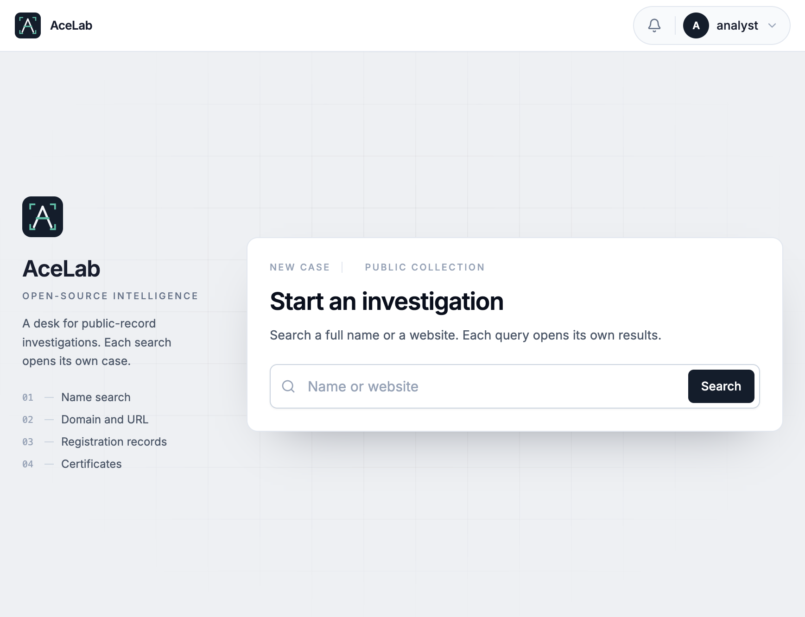

# Acelab OSINT

Acelab OSINT is a workspace for information gathering and footprinting. Start with a full name or a website. Each search opens its own case and records what public sources publish about that subject.

A match is a lead to verify. The workspace stores the observation, the source, and the time it was collected. It does not assert that an asset is malicious, and it does not name an operator.



## What a search collects

**Website.** Footprinting for a domain or URL uses public records:

- DNS answers and mail records
- Domain registration: registrar, dates, status, nameservers, and contacts the registry publishes
- Certificate transparency
- The network that currently announces the address, including holder and country
- Wayback capture dates, without downloading archived pages
- One snapshot of the submitted host, then linked pages on that same host: title, contacts, and linked files

**Full name.** A public page check keeps pages that contain the name. Generic pages and mail-provider sites are dropped. A hit is a lead, not proof of who runs the site.

Those sources do not need an API key. They do not include paid address history, backlinks, or search rankings. URLHaus and optional report narration stay off until their keys are set.

## How a case is kept

Observations are appended. A later collection does not delete an earlier one. A website case is drawn as a relationship graph. Rare artifacts in that case — a distinctive page structure, a non-generic logo path, an uncommon nameserver, or a contact that is not privacy-redacted — can be compared with the analyst's saved cases. Shared hosting and public DNS stay out of that comparison. Saving a case includes it in later searches.

The report can export a handoff in which each claim cites an observation. Association scores are a transparent heuristic for explanation. They are not probabilities.

## Local demo

```bash
python3 -m venv .venv
.venv/bin/pip install -r backend/requirements.txt
cd backend && ../.venv/bin/python -m uvicorn app.main:app --port 8000
```

In another shell:

```bash
cd frontend
npm ci
npm run dev
```

Open `http://127.0.0.1:5173`. The desk opens directly on the local analyst account. Startup creates the development accounts. It does not load an investigation.

Set `DEMO_MODE=true` to store only the submitted indicator for a domain, URL, address, or fingerprint. A full name still checks public pages.

## Docker Compose

```bash
cp .env.example .env
docker compose up --build
```

The UI is published on `http://localhost:8080`. Copy `.env.example` to `.env` on the machine that runs Compose. `.env` is not part of the repository. Postgres is canonical. Redis and a Celery worker run investigations when `INVESTIGATION_EAGER=false`. Neo4j is optional:

```bash
docker compose --profile neo4j up --build
```

Set `NEO4J_URI=bolt://neo4j:7687` on the API and worker when that profile is enabled. If Neo4j is unset or unavailable, graph algorithms use NetworkX and the API still serves the Postgres graph.

## Tests

```bash
cd backend && ../.venv/bin/python -m pytest
cd frontend && npm test
cd frontend && npx playwright test
```

## Optional narration

Narrative text is optional. Set `OPENROUTER_API_KEY` and, if you want a different model, `OPENROUTER_MODEL`. The client calls only `https://openrouter.ai/api/v1/chat/completions`. Without a key, or if the call fails, the report stays the evidence summary and `narrative_status` is `skipped` or `failed`.

## Documentation

- [Architecture](docs/architecture.md)
- [Data sources](docs/data-sources.md)
- [API](docs/api.md)
- [Security](docs/security.md)
- [Operations](docs/operations.md)
- [Dependencies](docs/dependencies.md)

## Limits

Containers starting does not make this a finished production deployment. TLS, a separate migration role, secret management, and provider terms are still configuration. See the operations and security notes. PDF export is not implemented.
