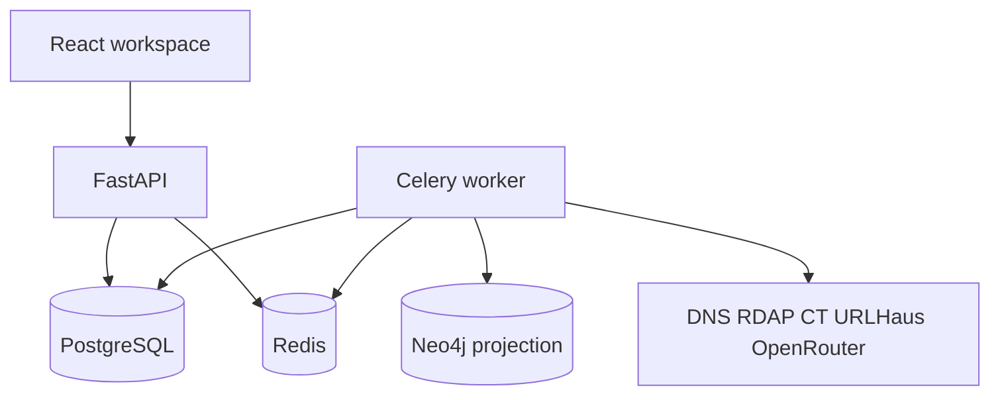

# Architecture

PostgreSQL stores users, investigations, entities, observations, relationships, indicators, assessments, notes, audit events, and export jobs. It is the canonical record. Neo4j, when `NEO4J_URI` is set, is rebuilt from those rows for one investigation at a time. A failed projection does not change the canonical rows. Graph queries from the API read PostgreSQL and analyse them with NetworkX.

An investigation request validates the indicator, stores a job, and returns immediately. In local demo mode the job runs in process. In Compose the worker runs it. Steps are collect, normalise, extract relationships, score, analyse, optionally project, and write a report.

Observations are appended. A later retrieval does not delete an earlier observation. `observed_at` is the time the source gives for the event. `retrieved_at` is when PIAE stored the row.

## Scoring

`heuristic_baseline_v1` records a weight for relationship type, source reliability, rarity, temporal overlap, corroboration, threat-indicator match, conflict, and staleness. Shared CDN, shared hosting, a common certificate authority, public DNS, and page markup are capped as insufficient. The weights are a transparent starting point for explanation. They are not a validated probability model.

## Campaign memory

After collection, PIAE compares rare artifacts in the investigation with that analyst's saved cases. A rare artifact is a kit structure (distinctive form fields and script names), a non-generic logo path, an uncommon nameserver, or a contact that is not privacy-redacted. Public DNS and artifacts shared by many saved cases stay off the graph. A match records the shared artifact. It does not name an operator and it does not assert that an asset is malicious. The graph payload includes those matches and a timeline of published registration dates, earliest certificate not-before dates, and Wayback capture dates.

## Demonstration graph

While demonstration mode is on, a search stores the submitted indicator and does not add domains, addresses, certificates, or other infrastructure. Turn `DEMO_MODE` off and enable a source to collect from DNS, RDAP, certificate transparency, or URLHaus.
